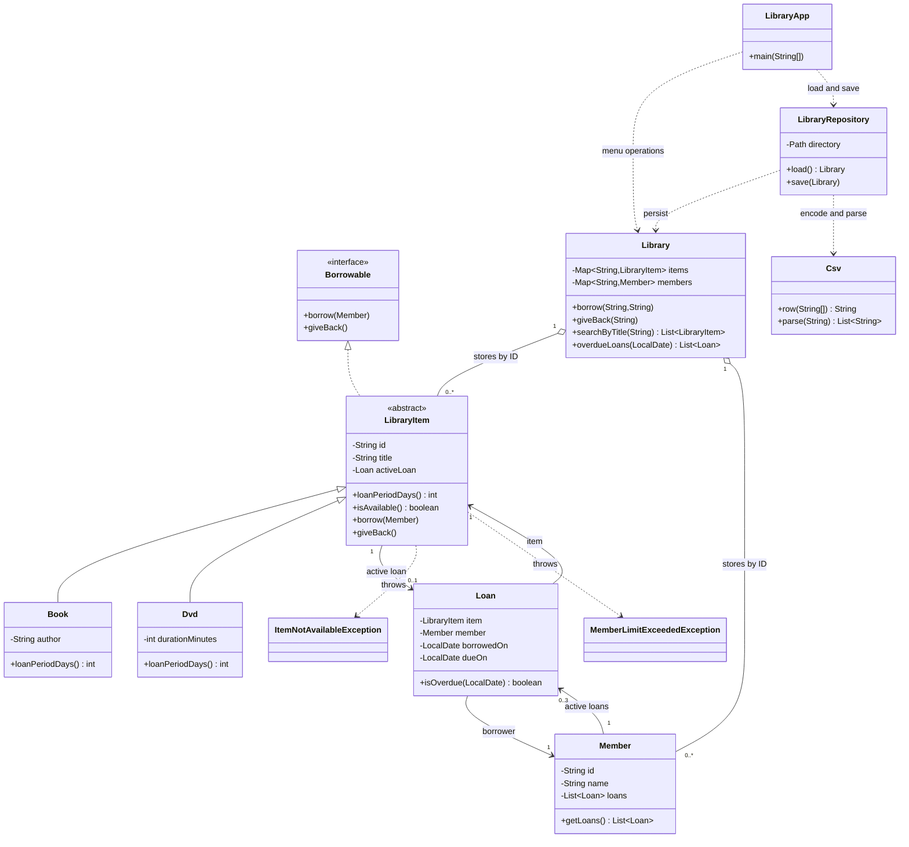

# Library Management System class diagram

An open triangle with a solid line denotes inheritance; an open triangle with a dashed line denotes interface implementation. The member has zero to three active loans; an item has at most one. The service stores existing objects, while each Loan links a member to one item and its dates. The CSV repository and menu depend on the service rather than duplicating borrowing rules.
